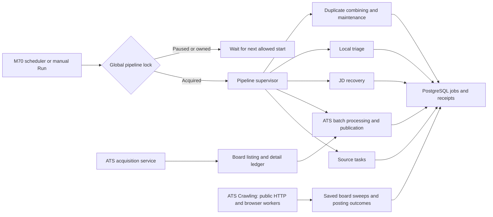
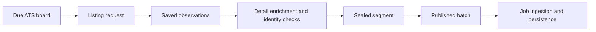
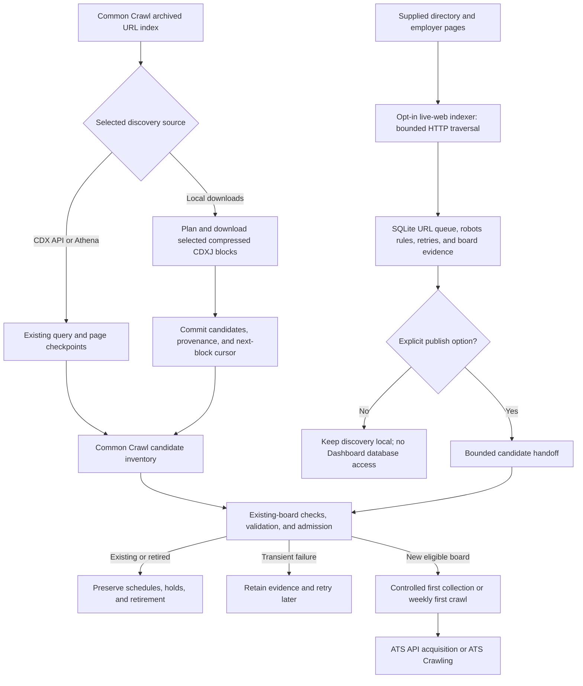
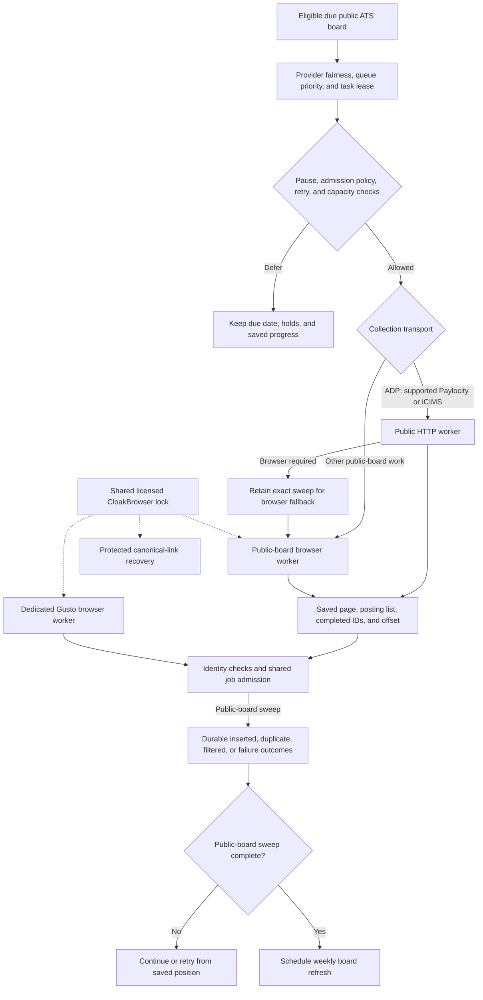
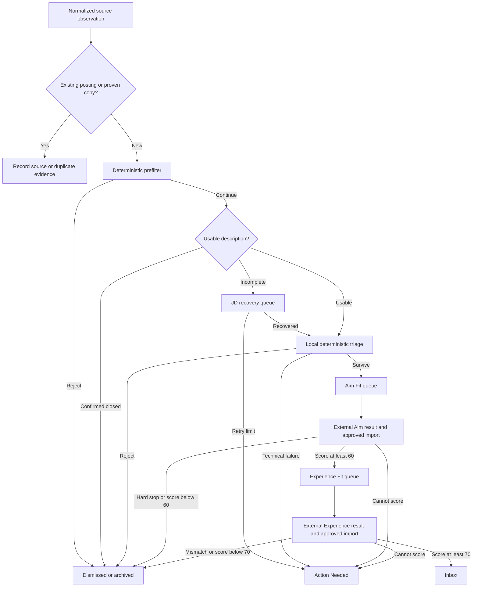
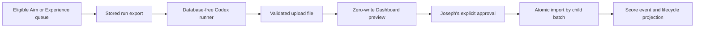

# Career Dashboard pipeline

This is a readable map of the implementation, checked against the repository on October 21, 2026. It covers board discovery and indexing, API acquisition, ATS Crawling, job admission, and manual scoring. Service availability and optional feature activation require live checks. See the [pipeline contract](docs/CAREER_DASHBOARD_PIPELINE_CONTRACT.md) for detailed stage rules and the [M70 guide](docs/M70_PRODUCTION_OPERATIONS.md) for production operation.

## 1. Runtime and acquisition

The M70 scheduler checks for a due pipeline run every minute. A manual start uses the same global lock. The pipeline supervises independent loops, so one provider or recovery failure need not stop the others. ATS API acquisition and ATS Crawling use separate workers outside that supervisor. All collection lanes feed the shared job admission path.

| Separate M70 work | Purpose |
| --- | --- |
| Scheduler | Checks pipeline start conditions every minute. |
| Watchdog | Checks repair conditions every 15 minutes, with bounded repair authority. |
| Backup | Creates daily database and runtime backups on the M70 and dedicated SSD. |
| Common Crawl discovery | Weekly incremental discovery. The exhaustive audit uses a separate service and shares the discovery lock. Source selection controls CDX API, Athena, or local index downloads. |
| Live-web indexer, opt-in | Resumes bounded discovery passes one minute after completion, with jitter. Requires its own enablement marker and seed file. |
| First-collection admission | Validates and admits waiting boards under provider, health, and capacity controls. |
| Public-board browser crawling | Resumes bounded turns about fifteen seconds after completion, with jitter. Retains per-board page and posting checkpoints. |
| Public-board HTTP crawling | Independently collects ADP and supported Paylocity/iCIMS sweeps about fifteen seconds after completion, with jitter. |
| Gusto crawling | Uses its own browser profile and resumes one minute after each completed pass, with jitter. |
| Stored and API canonical URL recovery | Repairs unresolved links from saved ATS postings and supported employer APIs, ten minutes after completion. |
| Canonical URL resolver | Rechecks protected aggregator links through the browser hourly. |
| Board pruning review | Weekly liveness sweep rechecks demoted boards and may promote boards with postings or retire confirmed dead boards. Other pruning arms report candidates for approval. |

The [M70 unit files](scripts/deployment/m70/) define the schedules. A timer file being present in Git does not prove the timer is enabled on the host.

### ATS API acquisition has several checkpoints

Each checkpoint has its own receipt and retry behavior. A contacted or responding board does not, by itself, prove that a complete posting reached the Dashboard. Platform fairness, provider cooldowns, a bounded worker pool, and backlog pressure determine which eligible work runs next. Previously downloaded work can continue through processing even when new board acquisition pauses.

## 2. Board discovery and indexing

Discovery finds supported ATS board identities. Validation and admission decide whether a new board can enter collection. The live-web indexer and Common Crawl reader have independent state and do not collect jobs themselves.

The [Common Crawl index reader](docs/COMMON_CRAWL_LOCAL_DISCOVERY.md) streams a directory and reads selected compressed index blocks, rather than archived web-page content. Local-download progress has its own saved plan and cursor; existing API offsets and Athena query IDs remain intact. Completion requires every planned block and exact discovery receipt. Source selection is explicit, with no automatic paid/API fallback from local mode.

The [live-web indexer](docs/ATS_WEB_DISCOVERY.md) follows public HTML links and recognized embedded ATS URLs. It honors robots rules and per-site delays, validates public network destinations, and bounds requests, bytes, time, depth, and storage. It does not render JavaScript or extract jobs from custom employer pages. Its M70 unit is opt-in: a release installs the code without enabling discovery. Publishing candidates preserves existing boards and uses the established admission controls.

## 3. ATS Crawling

The Dashboard's **ATS Crawling** status row groups Gusto with fourteen public-board families: ADP, Avature, BrassRing, DZConneX, iCIMS, Paycom, Paylocity, Phenom, Sage HR, Talemetry, classic Taleo, Jobvite, Freshteam, and CATS. These providers are excluded from ordinary ATS API acquisition. Collection ownership stays the same when transport changes between public HTTP and the licensed browser.

The public HTTP worker does not occupy the browser lock. Browser fallback shares the provider's task lease and board checkpoints; HTTP activity does not reset the browser fallback's fairness clock. The licensed browser remains serial across public-board crawling, Gusto, and protected canonical-link recovery.

For public-board sweeps, a page advances only after each posting has a durable outcome. Bounded turns, provider failures, and restarts retain continuation evidence. A partial sweep or a page that advertises more postings than were saved cannot count as a complete collection. Existing cards and scores survive partial sweeps and closed postings. See the [collector scheduling and operations guide](docs/M70_PRODUCTION_OPERATIONS.md#ats-crawling-lane).

## 4. A job's path

Arrows describe eligibility, not a single synchronous request. A source can return a duplicate, a closed page, or an incomplete description. The Dashboard protects user decisions while these background stages run.

JD recovery first tries structured provider or ATS data. Jina Reader is a fallback when structured recovery is unusable. It does not decide fit. Local triage is deterministic and does not call a model. Same-job consolidation can combine proven copies before export, after a scoring import, or during maintenance. It retains score records and provides an undo path for an incorrect combination. See the [measured combining rules](docs/SAME_JOB_CONSOLIDATION_2026-09-25.md).

| Job field | Meaning in this flow |
| --- | --- |
| `status` | Lifecycle disposition, such as `pending_af`, `inbox`, `dismissed`, or a protected human decision. |
| `scoringStatus` | Processing state, such as `needs_jd`, `queued`, `scoring`, `scored`, `skipped`, or `failed`. |
| Stage and work leases | Temporary ownership of JD recovery, local triage, or a manual scoring export; separate from both fields above. |

A local survivor remains `pending_af` with `scoringStatus = scored` until manual scoring resolves it. Inbox means the Experience threshold was met. A failed technical stage belongs in Action Needed; it is not an implicit permission to rescore.

## 5. Manual scoring exchange

The Dashboard does not run the scoring models. It creates a stored, exact export. Codex processes the JSON outside the application, and the Dashboard independently checks the returned result before any write.

- Aim and Experience are independent stages. An Aim result needs to clear the Dashboard-owned 60-point floor before Experience export. Experience checks hard requirements against the exact JD and trusted evidence, then scores qualified roles on a 0–100 scale. The Inbox floor is 70.
- New whole-queue runs contain up to **200 jobs**, split into exact 40-job child batches, and may not exceed **64 MiB**. One nonterminal run per stage can exist at a time. The same exact export can resume incomplete work.
- Experience runs with proposed `hard_requirement_mismatch` results pause for semantic review. Each mismatch must be checked against the exact JD and Core Evidence before the upload file is finalized.
- Preview performs no writes. Apply rechecks membership, inputs, hashes, current score authority, lifecycle protection, and the preview-bound approval token under transactional locks. Accepted child batches remain accepted if a later child cannot apply.
- Existing scores remain honored through prospective changes to policy, model, evidence, code, or versions. An explicit user request to remove scores or a Dashboard rescore action is required to displace them.

The [canonical resume record](docs/CANONICAL_RESUME.md) identifies the current Experience input. The [scoring runner](scripts/run_scoring_run.py) and [Experience review finalizer](scripts/finalize_experience_scoring_run.py) handle the external exchange.

## Implementation map

| Behavior | Main implementation |
| --- | --- |
| Pipeline lock, pause, and supervised loops | `src/app/api/pipeline/run/route.ts`, `src/app/api/pipeline/stop/route.ts`, `src/lib/pipelineState.ts` |
| Source scheduling, provider state, and ingestion | `src/lib/ingestionTaskCatalog.ts`, `src/lib/ingestionControl.ts`, `src/lib/jobIngestion.ts` |
| ATS listing, enrichment, publication, and batch processing | `src/lib/atsAcquisitionDispatcherV2.ts`, `src/lib/atsAcquisitionLedger.ts`, `src/lib/atsAcquisition.ts` |
| Common Crawl index download plans, block commits, and discovery receipts | `src/lib/localCommonCrawl.ts`, `src/lib/localCommonCrawlAudit.ts`, `scripts/audit_ats_common_crawl.ts` |
| Live-web traversal, SQLite checkpoints, robots policy, and candidate handoff | `scripts/crawl_ats_boards.ts`, `src/lib/atsWebDiscovery.ts`, `src/lib/atsWebDiscoveryState.ts`, `src/lib/atsWebDiscoveryRobots.ts`, `src/lib/atsWebDiscoveryHandoff.ts` |
| Controlled validation and first-collection admission | `src/lib/atsFirstCollectionAdmission.ts`, `src/lib/atsFirstCollectionController.ts`, `src/lib/atsBoardDiscovery.ts` |
| Public-board crawl scheduling, transport, and durable sweep progress | `src/lib/atsCrawlingSchedule.ts`, `src/lib/browserAtsWorker.ts`, `src/lib/browserAtsTransportReader.ts`, `src/lib/browserAtsProgress.ts` |
| Dedicated Gusto collection and shared browser ownership | `scripts/sweep_gusto_boards.ts`, `scripts/deployment/m70/career-dashboard-gusto.service`, `scripts/deployment/m70/career-dashboard-public-boards.service` |
| Description recovery and local triage | `src/lib/jdRecoveryPolicy.ts`, `src/app/api/jobs/batch-jd-submit/route.ts`, `src/lib/jobScoring.ts` |
| Same-job combining and undo | `src/lib/sameJobMatch.ts`, `src/lib/sameJobConsolidation.ts` |
| Manual exports, run limits, preview, and import | `src/lib/scoringRun.ts`, `src/lib/scoringLimits.ts`, `src/lib/scoringImport.ts`, `src/lib/scoringApproval.ts` |
| Durable database state and score history | `prisma/schema.prisma`, `src/lib/jobLifecycleEvents.ts` |
