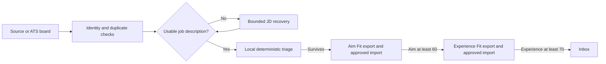

# Career Dashboard

Career Dashboard collects job postings, checks that they are usable, and helps Joe decide which opportunities deserve attention. Automated discovery and local checks prepare jobs for review. **Aim Fit** and **Experience Fit** are separate, manual scoring exchanges: the Dashboard exports exact inputs, Codex runs outside the application, and Joe approves the import after a preview.

Production runs on the [M70](docs/M70_PRODUCTION_OPERATIONS.md). The former Pi database is a historical archive. The Dashboard has no login screen; access is through Joe's Tailscale network.

## At a glance

| Area | What happens |
| --- | --- |
| Board discovery and indexing | Common Crawl index scans and an opt-in live-web indexer find supported ATS boards. Candidates pass through existing validation and first-collection controls before collection. |
| Job collection | Scheduled searches and feeds, ATS API acquisition, and the separate **ATS Crawling** lane collect postings. Crawling uses public HTTP and licensed-browser workers with saved board progress. |
| Admission | Source identity, duplicate checks, description recovery, language and metadata checks, and local deterministic triage prepare jobs for Aim Fit. |
| Aim Fit | A manual export binds each job to its original description, trusted metadata, policy, and question registry. A result below the Dashboard's 60-point Experience queue floor does not advance. |
| Experience Fit | A separate manual export binds the current Aim result, canonical resume, and Core Evidence. A hard-requirement mismatch scores zero; a result of 70 or more enters Inbox. |
| Review | Joe decides what to apply to, pass on, or revisit. His lifecycle decisions and existing scores remain authoritative. |

The [pipeline diagrams](PIPELINE_FLOW.md) show board discovery, the separate API and crawl collection lanes, the job path, and the manual scoring exchange.

## How a job reaches Inbox



Closed postings, duplicate copies, and deterministic rejections take their own documented paths. Technical failures go to **Action Needed** for review. A job with an existing score is not automatically cleared or requeued because a policy, prompt, evidence file, or version changes. Only Joe's explicit request to remove a score or his Dashboard rescore action can change that authority.

### Board discovery and the new indexer

Two discovery paths find boards for ATS platforms the Dashboard already supports:

- **Common Crawl index reader:** searches archived URL captures. In local-download mode, it downloads selected compressed CDXJ index blocks over HTTPS, matches supported board identities, and saves candidates, provenance, and restart checkpoints. It reads index records rather than archived page content. Existing CDX API and Athena progress remain separate. See [Common Crawl index discovery](docs/COMMON_CRAWL_LOCAL_DISCOVERY.md).
- **Live-web indexer:** starts from supplied directories or employer pages, follows public HTML links, and records recognized ATS destinations. A dedicated SQLite database retains the queue, page visits, robots rules, retry holds, and discovery evidence. Requests, bytes, depth, storage, and per-site traffic are bounded. This worker uses ordinary HTTP; it does not render pages or extract jobs from custom career sites. See [supported-ATS web discovery](docs/ATS_WEB_DISCOVERY.md).

Finding a board does not start job collection. The live-web indexer opens no Dashboard database unless its explicit publish option is selected; publishing hands a bounded candidate batch to existing validation and first-collection admission. Existing boards retain their schedules, holds, and retirement decisions. Common Crawl source selection and live-web activation are explicit operator choices. The live-web service requires its own enablement marker and seed file; deploying its code does not enable it.

### Job collection: API acquisition and ATS Crawling

The Dashboard separates three collection lanes:

| Lane | What it collects and how it resumes |
| --- | --- |
| Source searches and feeds | Configured paid searches, CareerForce, free feeds, credential-gated providers, and scheduled LinkedIn/Dice Apify datasets. |
| ATS API acquisition | Supported employer feeds through a separate M70 worker and durable ledger. Listing, detail enrichment, sealing, publication, and persistence have independent checkpoints. Provider budgets, cooldowns, and backpressure limit work. |
| **ATS Crawling** | Gusto and fourteen public-board families through dedicated workers outside API acquisition. Licensed-browser collection and public HTTP collection share stable posting identities and saved board progress. |

The public-board families are ADP, Avature, BrassRing, DZConneX, iCIMS, Paycom, Paylocity, Phenom, Sage HR, Talemetry, classic Taleo, Jobvite, Freshteam, and CATS. ADP runs through public HTTP. Supported Paylocity and iCIMS sweeps try HTTP and retain their exact saved position when browser fallback is needed. Gusto has its own timer and browser profile. Browser workers and protected canonical-link recovery share one licensed CloakBrowser session; the HTTP worker runs independently of that browser lock.

Crawling saves the current page, posting list, completed posting IDs, and continuation position. A page advances only after its postings have durable outcomes. Partial turns and failures keep their checkpoints for continuation or retry; a responding page is not proof of a complete sweep. Provider fairness, retry holds, operator pauses, and ingestion capacity govern the next turn. The Dashboard reports this work in the **ATS Crawling** status row. See the [collector operations and scheduling rules](docs/M70_PRODUCTION_OPERATIONS.md#ats-crawling-lane).

### Admission and recovery

The pipeline supervises source ingestion, ATS batch processing and publication, JD recovery, local triage, duplicate combining, and stale-work cleanup. A separate weekly board review can return live demoted boards to rotation or retire confirmed dead ones; its other pruning decisions require approval. Canonical-link recovery uses separate stored/API and protected-browser workers. The exact stage rules live in the [pipeline contract](docs/CAREER_DASHBOARD_PIPELINE_CONTRACT.md).

New postings are normalized and matched to prior observations before a new Job is created. Incomplete descriptions enter bounded recovery, which tries structured ATS or provider data before Jina Reader. A usable description then receives local, deterministic checks. Independent maintenance loops combine sufficiently proven copies across sources while preserving each copy's score history and Joe's actions; he can undo an incorrect combination. See the [same-job rules](docs/SAME_JOB_CONSOLIDATION_2026-09-25.md).

### Manual scoring

1. In the Dashboard, export the entire eligible **Aim Fit** or **Experience Fit** queue. The download is named `START-AIM-FIT-RUN-<run-id>.json` or `START-E-FIT-RUN-<run-id>.json`.
2. Attach that exact file in Codex. The repository's manual scoring runner processes only the stage named by the file, without database access. Downloading the file alone starts nothing.
3. Review the resulting upload in the Dashboard's zero-write preview. The import applies only after explicit approval. An Experience run containing proposed hard-requirement mismatches first needs semantic review against the exact job descriptions and Core Evidence.

Each run contains child batches of 40 jobs, with a **200-job and 64 MiB limit** for new exports. The controller can resume an interrupted exact export. Accepted children stay accepted if a later child needs repair. A failed score is routed to Action Needed instead of silently cycling back into a scoring queue. The Dashboard checks batch membership, current inputs, score authority, approval token, and protected lifecycle state again when applying a result.

The [canonical resume record](docs/CANONICAL_RESUME.md) identifies the approved Channel Business Manager resume used for future Experience exports. The [Core Evidence inventory](docs/Candidate_Evidence_Inventory_-_Core_v1.md) defines factual candidate claims. Replacing either input affects future exports; it does not rewrite past scores.

## Local development

Use **Node 24**, as specified by `.nvmrc`, and a PostgreSQL database configured in `.env`:

```bash
nvm install
nvm use
npm ci
cp -n .env.example .env
npx prisma generate
npm run dev
```

Edit `.env` with local credentials before starting. The `cp -n` command leaves an existing `.env` untouched. Open <http://localhost:3000>. Database migrations and production releases should follow the [M70 operations guide](docs/M70_PRODUCTION_OPERATIONS.md); do not use a local schema command against production as a setup shortcut.

## Reference map

| Need | Start here |
| --- | --- |
| Understand every stage and state transition | [Pipeline flow](PIPELINE_FLOW.md) and [pipeline contract](docs/CAREER_DASHBOARD_PIPELINE_CONTRACT.md) |
| Understand board discovery and indexing | [Common Crawl index discovery](docs/COMMON_CRAWL_LOCAL_DISCOVERY.md) and [live-web indexer](docs/ATS_WEB_DISCOVERY.md) |
| Operate ATS Crawling and inspect saved progress | [Public-board collectors and crawl scheduling](docs/M70_PRODUCTION_OPERATIONS.md#public-employer-board-collectors-october-17-2026) |
| Operate or release production | [M70 operations](docs/M70_PRODUCTION_OPERATIONS.md) |
| Check the supported Node runtime | [Node runtime alignment](docs/NODE_RUNTIME_ALIGNMENT.md) |
| Change a pipeline or scoring rule safely | [Pipeline change guardrails](docs/CAREER_DASHBOARD_PIPELINE_CHANGE_GUARDRAILS.md) |
| Check resume and evidence authority | [Canonical resume](docs/CANONICAL_RESUME.md) and [Core Evidence](docs/Candidate_Evidence_Inventory_-_Core_v1.md) |
| Understand saved job documents | [Job documents](docs/JOB_DOCUMENTS.md) |

Historical investigations and implementation plans remain in `docs/` for context; the links above are the starting points for current behavior.
